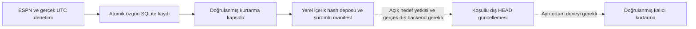

# FAZ36 — operasyonel güvenilirlik ve kalıcı durum mimarisi

Taban `a1fd5171109f563251f9cc8a71ee6fe273a3586e`, geliştirme dalı
`feature/nba-command-20261104`, PR #12. Taban SHA, PR başı, push ve PR
unit-tests/docker-build başarıları bağımsız doğrulandı. PR açık/taslak;
merge veya üretim dağıtımı yapılmadı.

## 5 Kasım 2026 20:00 UTC kesiti

Gerçek ESPN takvimi tekrar sorgulandı. 18 yaklaşan NBA normal sezon maçı için
54 kesit durumu var: 2 MISSED_CUT, 52 NOT_DUE, **0 DUE**. İlk sonraki kesit
**5 Kasım 20:00 UTC / 23:00 Türkiye**. ESPN 401909936 maçının başlangıcı
6 Kasım 02:00 UTC; bu kesit T6H'dir. 401909937 için T6H, 5 Kasım 21:00 UTC.
Takvim her çağrıda tekrar doğrulanır; eski plan gerçek çalışma izni sayılmaz.

Yeni gerçek prospektif tahmin **0**, uygun canlı eğitim örneği **0**.
Tahmin oluşmadığı için yeni tahmin SHA'sı veya gerçek doğruluk metriği yoktur.
Gerçek saat gelmeden tahmin oluşturulmadı; kaçırılmış T24H kesitleri doldurulmadı.
FAZ31 eğitilmemiştir; zamanı gelen uygun kayıtta NO_MODEL_AVAILABLE korunur.

## Mevcut korumalar

FAZ33/34/35 yolu aynen kullanılır: kaynak gözlem ve ingestion zamanı,
gerçek kesim/oluşturulma/kayıt zamanı, UTC maç başlangıcı, model SHA ve veri
kapsamı özgün pakette bağlanır. FAZ13/FAZ28 referansı ve gölge model durumu
aynı SQLite transaction'ında saklanır. Hash/anlamsal replay, gerçek saat
koruması, immutable trigger'lar, benzersiz maç/kesit anahtarı ve aynı dosya
sistemindeki süreç kilidi korunur. Üretim katsayıları değiştirilmedi.

Yeni yarış testleri, planlamadan sonra pencere kapanınca eski saate kayıt
yapılmadığını ve başka süreç arada kaydederse ikinci tahmin oluşmadığını
kanıtlar. Eksik/kanıtsız geçmiş kaynakla kısmi tahmin paketi yazılmaz.
Bağlantı/403/429/timeout, kesinti günlüğü ve SQLite kilidi önceki regresyonlarla
birlikte çalıştırılır. Sentetik testler gerçek performans sayılmaz.

## Kalıcı durum mimarisi — henüz dışarıda etkin değil



**Kalıcı depolama hazır değil.** Yetkili harici hedef yoktur; dış yükleme
adapter'i çalıştırılmadı. Aktif pilot LOCAL_ONLY kalır. Aynı Cloud dosyalarının
hâlâ bulunması yeni oturumda kalıcılık kanıtı değildir. Gerçek ayrı Cloud
ortamında restore ve dış depodan geri indirme **doğrulanmadı**.

`faz36 stage` yeni bir tahmin üretmez. Mevcut FAZ35 kapsül işleviyle snapshot
alır ve yalnızca yerel bir durum protokolünü uygular:

1. Kapsülün dışarıdan beklenen SHA'sı, SQLite bütünlüğü ve mevcut anlamsal
   tahmin/sonuç doğrulamaları kontrol edilir.
2. Tahmin, özgün girdi, sonuç, kaynak gözlemi ve operasyon satırları için kimlik
   ve tam satır digest envanteri oluşturulur. Bu satır sayısı maç sayısı değildir.
3. Kapsül `capsules/<SHA256>.tar.gz` altında; manifest `manifests/<SHA256>.json`
   altında içerik hash'iyle saklanır. Kaynak dosyalar değiştirilmez.
4. Manifest generation, parent_sha256, source_version, gerçek metadata oluşturma
   zamanı, kapsül hash'i ve envanter hash'ini içerir. Bunlar tahmin zamanı yerine
   kullanılmaz.
5. Yerel kilit altında beklenen parent güncel HEAD ile karşılaştırılır. Eski
   parent reddedilir. Önceki özgün satır kaybolmuş veya değişmişse yayın reddedilir.
6. Aynı kapsül tekrar verilirse yeni generation üretilmez. Farklı generation
   sayısı tahmin veya eğitim örneği sayısı değildir.
7. Dosyalar fsync/no-clobber ile yazılır; HEAD atomik değiştirilir. HEAD, immutable
   manifest ve yerel kapsül hash'i tekrar karşılaştırılır.

Yerel protokolün kapsamı **LOCAL_STAGING_ONLY**, external_committed=false'tur.
Farklı makinelerdeki iki flock birbirini korumaz. Yerel testlerin geçmesi
provider-backed atomik CAS veya dağıtık kilit garantisi değildir. Yeni ortamda
eski bir yerel HEAD'i açmak, dış hedefin güncel HEAD'ini okumuş olmak sayılmaz.
SHA-256 bütünlük kontrolüdür; kaynak imzası veya harici yükleme makbuzu değildir.

Dış yayın için [protokol sözleşmesi](../ops/faz36/state-publication.contract.json)
hazırlandı. Gerçek hedef yetkisi, görünürlük, ücretsiz kota/retention,
immutable nesneler, koşullu HEAD yazımı (güncel provider version/ETag), bütün
writer'lar için koordinasyon ve ayrı ortam restore testi gerekir. Hedef
onaylanmadan dosya/SQLite paketi dışarı taşınmaz. Kapsül ve manifest dışarıda
doğrulanmadan bir receipt veya durable=true kaydı üretilmez.

## Zamanlayıcı seçenekleri

| Seçenek | Hazırlık | Zamanlama ve durum riski |
|---|---|---|
| Mevcut yetkili kalıcı geliştirme host'unda yerel timer | Service/timer taslakları hazır; kurulmadı | Host, saat, ağ ve kalıcı disk ayakta olmalı; kesin zaman garantisi yok |
| GitHub Actions hosted schedule | Değerlendirildi; etkin workflow/cron eklenmedi | Gecikme/düşen işler; 5 dakikalık en küçük aralık, 5 dakikalık kesit penceresine eşit; disk ephemeral |
| Persistent self-hosted runner | Mevcut onaylı host varsa değerlendirilebilir | Disk/uptime/erişim ve tüm writer koordinasyonu ayrıca doğrulanmalı; burada host kurulmadı |
| Codex Cloud içinde geçici watch | Komut mevcut | Oturum/iş kesilince kaybolabilir; kalıcı servis veya garantili saat tetikleyicisi değildir |

Resmî GitHub belgesi HTTP 200 ile doğrulandı:
https://docs.github.com/en/actions/reference/workflows-and-actions/events-that-trigger-workflows#schedule

Belge yüksek yükte, özellikle saat başlarında gecikme ve bazı kuyruktaki
işlerin düşmesini açıklar. Schedule dosyası default branch'te bulunmalıdır;
feature dalındaki bir cron kendi başına etkin değildir. Public repoda uzun
süre faaliyet yoksa schedule devre dışı kalabilir. Kullanıcının merge yasağı
korundu; default branch değiştirilmedi. GitHub concurrency grubu başka
makinedeki Codex/yerel writer'ı koordine etmez. Artifact süre dolumu da
kalıcı durum saklama yöntemi yerine geçmez.

Yerel taslaklar [ops/faz36](../ops/faz36/) altında `.example` uzantılıdır;
aktif systemd veya `.github/workflows` konumuna kurulmadı. Önerilen kontrol
aralığı 60 saniye, catch-up devre dışıdır. Uygulama geç çağrılsa bile geçmiş
kesit oluşturmaz. Hiçbir seçenek için zamanında çalıştırma garantisi verilmez.

## Komutlar ve hazır olma durumu

```sh
python -m faz36 readiness /ABS/PILOT/pilot-config.json --scheduler local_timer
python -m faz36 readiness /ABS/PILOT/pilot-config.json --scheduler github_actions
python -m faz36 stage /ABS/PILOT/pilot-config.json /NEW/LOCAL/publication

# Kesit anında gerçek pilot: erken çalıştırma yalnızca plan raporlar.
python -m faz35 pilot /ABS/PILOT/pilot-config.json
```

Readiness yerel komutun varlığı ile durable/unattended hazır olmayı ayırır.
Şu an sonuç **NOT_READY_FOR_DURABLE_UNATTENDED_COLLECTION**:
local_command_available=true; durable_storage_ready=false;
scheduler.enabled=false; ready_for_unattended_collection=false;
punctuality_guaranteed=false. Yerel manifest hazırlığı bu bayrakları açmaz.

Gerçek altı veritabanlı kapsül üzerinde yerel protokol denendi; 148 envanter
satırı doğrulandı. Bu sayı kaynak/tahmin/operasyon satırlarının toplamıdır;
148 gerçek maç veya yeni tahmin anlamına gelmez. Eski özgün kayıtların SHA'ları
ve dört model kaynak dosyasının SHA'ları değişmedi. Nihai temiz commit ile
pilot, staging ve readiness sonuçları ayrıca çalışma çıktısında raporlanır.

## Test sonucu ve sonraki işlem

**712 test başarılı**, 43.296 saniye; **13 yeni FAZ36 testi**. Beklenmeyen test
hatası yok. Beklenen ret senaryoları: stale parent, eksik/değişmiş özgün satır,
bozuk arşiv hash'i, yeniden hash'lenmiş bozuk SQLite, bozuk HEAD, bozuk kayıtlı
kapsül ve path traversal metadata. İki ayrı publisher süreci, aynı kapsülde
idempotency, gerçek collector yarışları, kapanan kesit penceresi ve eksik
kaynak kapsandı. Eski kesinti/SQLite/ağ testleri tam regresyonda tekrar geçti.
Bunlar sentetik/fault-injection doğrulamalarıdır; gerçek tahmin doğruluğu değildir.

Sonraki işlem: 20:00 UTC'de güncel takvimle pilotu çalıştırmak; bağımsız olarak
harici hedefi ve kalıcı host'u yetkilendirip backend CAS/independent restore
kabul testini tamamlamak. Bu koşullar sağlanmadan gözetimsiz, kalıcı veya
zamanı garantili bir sistem olduğu iddia edilemez. Yeni gerçek tahmin yok;
FAZ31 eğitilmemiştir, sakatlık/kadro/piyasa/toparlanma eksikleri ve tahmini tempo
sınırlamaları devam eder. PR merge, Fly.io ve Telegram üretim değişikliği yoktur.
